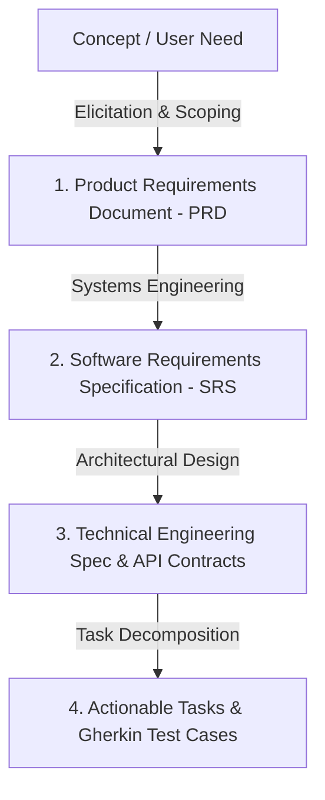

# Spec-Driven Development (SDD): PRD, SRS & Tech Spec Suite

This skill enforces rigorous **Spec-Driven Development (SDD)**. It translates conceptual features, user requests, or architectural proposals into unambiguous, machine-verifiable specifications before any code is written.

---

## 1. Document Types & Hierarchy

| Document | Standard / Format | Audience | Primary Focus | Reference Template |
| :--- | :--- | :--- | :--- | :--- |
| **PRD** | Modern Product standard | Stakeholders, PM, Engineers | The *Why* & *What*: User problems, personas, KPIs, feature scope (MoSCoW). | [prd_template.md](references/prd_template.md) |
| **SRS** | IEEE 830 / ISO 29148 | Systems & QA Engineers | System behavior, interfaces, non-functional requirements (NFRs), constraints. | [srs_template.md](references/srs_template.md) |
| **Tech Spec** | Engineering Blueprint | Core Developers | The *How*: Data models, API contracts, sequence diagrams, failure recovery. | [tech_spec_template.md](references/tech_spec_template.md) |

---

## 2. The 4-Stage SDD Workflow

### Stage 1: Interactive Elicitation ("Grill Me" Gate)
Before drafting documents, uncover hidden constraints and edge cases by interviewing the stakeholder:
1. **Target Users & Context:** Who uses this, in what environment, with what hardware constraints?
2. **Success Metrics:** What quantitative KPI defines success (e.g., *inference latency < 30ms*, *accuracy > 95%*)?
3. **Out-of-Scope (Non-Goals):** What are we explicitly *not* building in this milestone?
4. **Failure Modes:** What is the degraded fallback when network, camera, or model fails?

### Stage 2: Authoring the PRD
Focus on customer value and functional boundaries. Include:
- Executive Summary & Problem Statement.
- User Personas & User Journey Maps.
- Feature Scoping (Must-Have, Should-Have, Could-Have, Won't-Have).
- UX / Wireframe Descriptions.
- Success Metrics & Milestones.

### Stage 3: Engineering the SRS (IEEE 830)
Formalize software requirements:
- External Interface Requirements (User Interfaces, Hardware Interfaces, Software Interfaces, Communications Protocols).
- Specific Functional Requirements ($REQ-1$, $REQ-2$, etc.) with priority levels.
- Non-Functional Requirements:
  - Performance (P95/P99 latency, memory footprint, throughput).
  - Reliability & Fault Tolerance (reconnection policies, crash recovery).
  - Security & Privacy (biometric keypoint anonymization, local-first inference).

### Stage 4: Compiling the Technical Spec & Task Backlog
Translate requirements into an executable contract for coding agents:
- Database / State Schema (SQL tables, Pydantic models, JSON contracts).
- API Endpoints (OpenAPI / gRPC signatures, HTTP verbs, response payloads).
- Behavioral Sequence Diagrams (Mermaid).
- BDD Acceptance Criteria in Gherkin syntax (`Given ... When ... Then ...`).
- Atomic Task Breakdown with dependency DAG.

---

## 3. Standard Verification Criteria
A specification is only complete when:
- [ ] Every requirement has a unique identifier ($REQ-001$, $NFR-001$).
- [ ] Acceptance criteria are testable via automated unit or E2E tests.
- [ ] Non-functional requirements include measurable numerical thresholds.
- [ ] Edge cases (disconnects, empty inputs, malformed data) have explicit handling rules.
