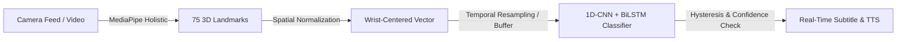

# Filipino Sign Language (FSL) Translation Engine

[](https://www.python.org/downloads/)
[](https://pytorch.org/)
[](https://developers.google.com/mediapipe)
[](https://onnxruntime.ai/)
[](./tests)

A mobile-first, low-latency **Filipino Sign Language (FSL)** translation engine designed to translate continuous and isolated sign language gestures in real time from live video feeds.

---

## Architecture Overview



### Core Pipeline Highlights
1. **Keypoint-Based Vector Pipeline:** Extracts hand (left & right) and upper-body pose landmarks into a compact 159-dimensional coordinate vector per frame, avoiding heavy 3D-CNN computation.
2. **Wrist-Origin Spatial Normalization:** Centers landmarks around the wrist origin and normalizes shoulder-to-hip scale, ensuring invariance across varying user distances from the camera.
3. **Temporal Resampling:** Automatically interpolates or downsamples variable-length gesture sequences into a consistent 30-frame temporal window.
4. **BiLSTM & ProtoNet Support:** Combines bidirectional temporal pattern recognition with few-shot Prototypical Networks for low-data vocabulary expansion.
5. **Mobile & Edge Ready:** Features direct ONNX export (`fsl_model.onnx`) for cross-platform deployment on mobile and edge devices.

---

## Repository Structure

```text
FSL_Project/
├── .agents/skills/            # Specialized development & ML agent skills
├── android/                   # Full Android Studio project & UI (sign_language_translator)
│   ├── app/src/main/res/      # Android UI layouts (activity_main.xml), icons, themes
│   ├── app/src/main/java/     # Kotlin tracking, classification, and CameraX pipeline
│   ├── app/src/main/assets/   # Bundled ONNX model and MediaPipe tasks
│   └── build.gradle.kts       # Android Gradle dependencies & SDK config
├── data/                      # Sample clips and metadata
├── FSL_Dataset/               # Recorded FSL video clips & landmark feature files (.MOV / .npy)
├── FSL_Features/              # Pre-extracted temporal feature vectors
├── models/                    # Pretrained models, tasks, and vocabularies
│   ├── best_model.pt          # PyTorch checkpoint (best validation loss)
│   ├── robust_model.pt        # Noise-augmented robust PyTorch model
│   ├── fsl_model.onnx         # Quantized/exported ONNX model for deployment
│   ├── vocab.json             # Vocabulary class mapping
│   └── tasks/                 # MediaPipe task models (hand & pose landmarkers)
├── scripts/
│   ├── extract_features.py    # Batch feature extraction script
│   ├── extract_top20_fast.py  # Fast parallel extraction for top 20 vocabulary
│   └── train_robust_model.py  # Model training with data augmentation & ONNX export
├── src/
│   ├── export/                # ONNX export routines
│   ├── models/                # PyTorch architectures (BiLSTM Classifier, ProtoNet)
│   ├── preprocessing/         # MediaPipe landmark extractors and spatial normalizers
│   ├── realtime/              # Sliding window stream inference engine
│   └── training/              # Training loops and loss definitions
├── tests/
│   ├── unit/                  # Unit tests (models, normalizers, pipelines)
│   └── integration/           # End-to-end integration tests
├── AGENTS.md                  # Workspace skills & customizations guide
├── pyproject.toml             # Project build configuration & tool settings
├── requirements.txt           # Core runtime dependencies
├── requirements-dev.txt       # Development & testing dependencies
└── README.md                  # Project documentation
```

---

## Installation & Setup

### Prerequisites
* Python 3.10 or higher
* Git

### 1. Clone the Repository
```bash
git clone https://github.com/Lyrics1022/FSL-Project.git
cd FSL-Project
```

### 2. Create and Activate Virtual Environment
```bash
# Windows (PowerShell)
python -m venv .venv
.\.venv\Scripts\Activate.ps1

# Linux / macOS
python3 -m venv .venv
source .venv/bin/activate
```

### 3. Install Dependencies
```bash
# Install core dependencies
pip install -r requirements.txt

# Or install in editable mode with development tools:
pip install -e ".[dev]"
```

---

## Usage Guide

### 1. Feature Extraction from Video
To extract normalized landmark features from the raw dataset:
```bash
python scripts/extract_top20_fast.py
```

### 2. Train the Classifier Model
To train the bidirectional LSTM model with data augmentation:
```bash
python scripts/train_robust_model.py
```
This script saves `models/robust_model.pt` and automatically exports `models/fsl_model.onnx`.

### 3. Run Real-Time Stream Inference
To run real-time inference on a webcam feed or test video:
```bash
python -m src.realtime.stream_inference
```

### 4. Run Automated Tests
```bash
pytest
```
All unit and integration tests run across normalizers, classifiers, and export pipelines.

### 5. Running the Android Studio App
1. Open **Android Studio**.
2. Select **Open an Existing Project** and navigate to the `android/` directory inside this repository.
3. Allow Gradle to sync dependencies (CameraX, MediaPipe Tasks Vision, ONNX Runtime Android).
4. Connect an Android device (or launch an emulator with camera support) and click **Run 'app'** (`Shift + F10`).
5. The mobile app loads the bundled `fsl_model.onnx` and performs live on-device Filipino Sign Language translation!

---

## License

This project is licensed under the MIT License.
